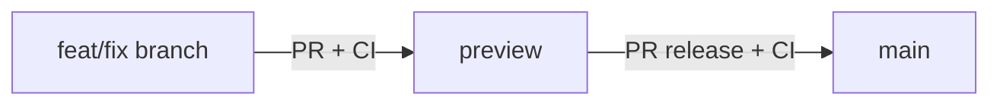

# Git workflow

## Branches

| Branch | Role |
|--------|------|
| `main` | Production (Vercel Production, usuarios reales) |
| `preview` | Staging integrado (validar en Vercel Preview antes de producción) |
| `feat/*`, `fix/*`, … | Trabajo diario; vida corta |

**Norma:** no abrir PRs de features directamente contra `main`.

## Flow



1. **Integración** — Crea la rama desde `preview`, abre PR **`base: preview`**.  
   - CI debe pasar.  
   - Revisa el despliegue de Vercel ligado a la rama/PR.

2. **Release** — Cuando `preview` esté estable, abre PR **`preview` → `main`**.  
   - Mismo CI.  
   - Tras merge, producción se actualiza en Vercel.

3. **Sincronizar** — Después de merge a `main`, actualiza `preview`:

```bash
git checkout preview
git pull origin preview
git merge origin/main
git push origin preview
```

## Comandos habituales

```bash
git fetch origin
git checkout preview
git pull origin preview
git checkout -b feat/mi-cambio

# … commits …

git push -u origin feat/mi-cambio
gh pr create --base preview --title "…" --body "…"
```

Release:

```bash
gh pr create --base main --head preview --title "Release: …" --body "…"
```

## Hotfix urgente en producción

Solo si no hay tiempo de pasar por `preview`:

1. Rama desde `main`, fix, PR **`→ main`**.  
2. Inmediatamente **`git checkout preview && git merge origin/main && git push`** para no diverger.

Documenta el hotfix en el PR.

## CI

El workflow [`.github/workflows/ci.yml`](../.github/workflows/ci.yml) corre en PRs hacia `preview` y `main`, y en pushes a esas ramas.
